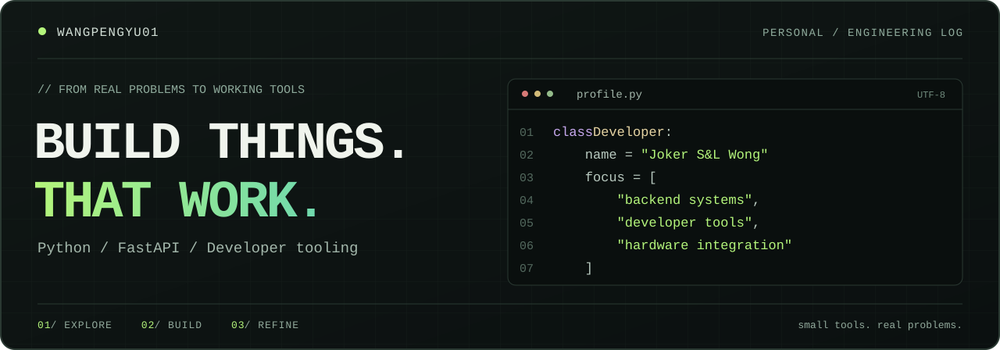
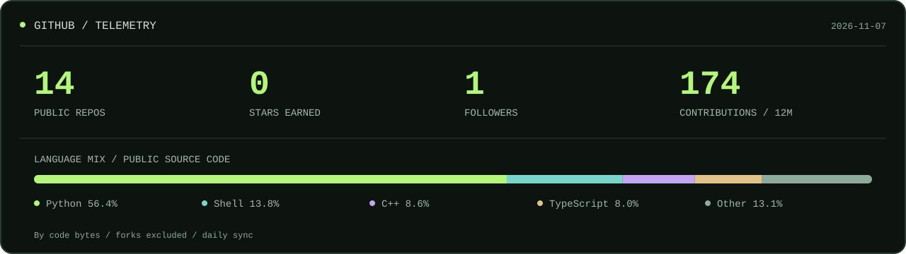
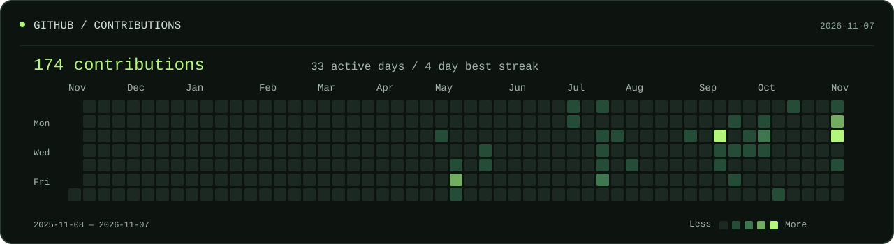
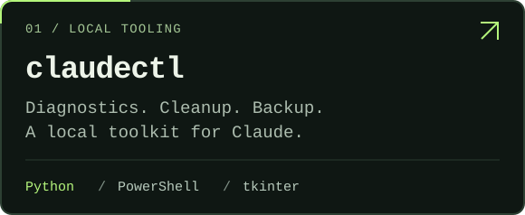
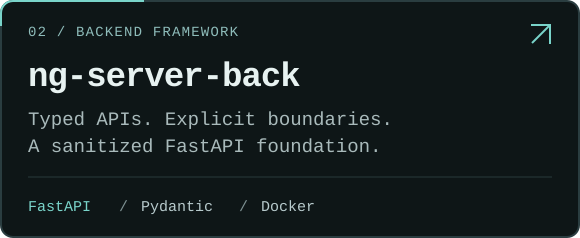
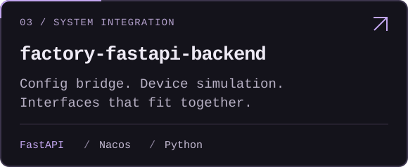
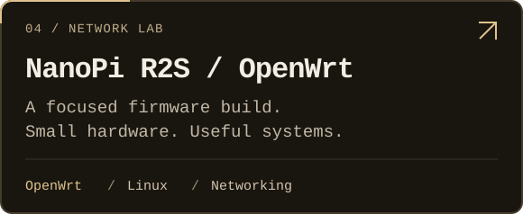

  

  <a href="#whoami">About</a> &nbsp; / &nbsp;
  <a href="#telemetry">Telemetry</a> &nbsp; / &nbsp;
  <a href="#selected-work">Selected work</a> &nbsp; / &nbsp;
  <a href="https://github.com/Wangpengyu01?tab=repositories">All repositories ↗</a>

### whoami

我是 **Joker S&L Wong**，也可以在这里找到我：`@Wangpengyu01`。

把重复的事交给工具，把复杂的接口整理清楚。这里主要记录 **Python 后端、开发工具与设备集成** 的实践，从一个实际问题开始，把它做成能用的东西。

`Python` &nbsp; `FastAPI` &nbsp; `Pydantic` &nbsp; `PowerShell` &nbsp; `Docker` &nbsp; `Linux`

### Telemetry

  <a href="https://github.com/Wangpengyu01?tab=repositories">
    <picture>
      <source media="(max-width: 640px)" srcset="./assets/stats-mobile.svg" />
      
    </picture>
  </a>

  <a href="https://github.com/Wangpengyu01?tab=overview">
    <picture>
      <source media="(max-width: 640px)" srcset="./assets/contributions-mobile.svg" />
      
    </picture>
  </a>

### Selected work

<table>
  <tr>
    <td width="50%" valign="top">
      
    </td>
    <td width="50%" valign="top">
      
    </td>
  </tr>
  <tr>
    <td width="50%" valign="top">
      
    </td>
    <td width="50%" valign="top">
      
    </td>
  </tr>
</table>

  Read the source. Understand the system. Make it useful.

